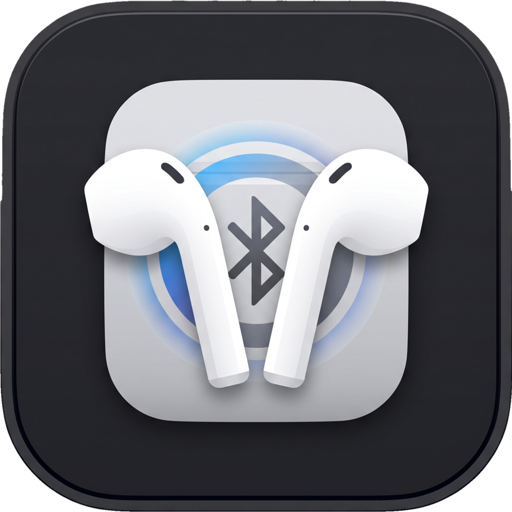

<p align="center"></p>

# AirPodsWin

A small tray app that brings an iOS/macOS-style AirPods panel to Windows: battery levels, volume and
audio output, one click away from the system tray.

## Features

- **Battery level** for the left earbud, the right earbud and the case, with a charging indicator.
  AirPods Max show a single battery ring.
- **Low battery alert** (below 20%) as a Windows notification, once per component.
- **iOS-style volume slider** kept in sync with the Windows volume. Click to jump, drag, or use the
  mouse wheel.
- **One-click mute**: click the speaker icon on the left of the slider to mute (the icon is crossed
  out) and click again to unmute.
- **Audio output selector** right from the panel.
- **AirPods only**: battery data and alerts are shown only while the active Windows audio output is an
  AirPods device. With any other output, the indicators are disabled and no alerts are sent.
- "Start with Windows" option in the tray icon menu.

## Supported models

| Family | Models |
| --- | --- |
| AirPods | 1st, 2nd, 3rd, 4th (including noise cancellation) and 5th generation |
| AirPods Pro | 1st, 2nd (Lightning and USB-C) and 3rd generation |
| AirPods Max | Lightning, USB-C and 2nd generation |

Beats and other Apple devices are ignored on purpose.

> Model identifiers and the AirPods Max battery format come from the open-source
> [CAPod](https://github.com/d4rken-org/capod) project. The decoder is covered by synthetic test frames,
> but not every model has been tested on real hardware (AirPods Pro 3, AirPods Max and the 5th
> generation in particular).

## How it works

- Battery levels are read from the Bluetooth LE advertisements that AirPods broadcast (Apple
  manufacturer data `0x004C`, type `0x07`, only known AirPods model IDs). No drivers are required.
- Volume and mute use Core Audio ([NAudio](https://github.com/naudio/NAudio)). Output switching uses the
  undocumented `IPolicyConfig` COM interface.

## Limitations

- Apple only broadcasts battery levels in **10% steps**.
- AirPods only broadcast their battery while the **case lid is open** or the earbuds are in use;
  otherwise the case shows as "—".
- **Noise control (ANC / Transparency) is not possible**: it relies on a proprietary Apple L2CAP
  channel that the Windows Bluetooth stack does not expose to applications (`WSAENETDOWN`).
- If several AirPods are nearby, the one with the strongest signal is used.
- The audio output is detected as AirPods by its Windows device name, so it must contain "AirPods".
- With **Smart App Control** turned on, Windows blocks the executable because it is not signed with a
  recognized certificate. Turn it off, or build and sign it with a valid code-signing certificate.

## Build

Requirements: Windows 10 (build 19041) or later and the [.NET 8 SDK](https://dotnet.microsoft.com/download).

```powershell
dotnet publish -c Release -r win-x64 --self-contained false -o publish
.\publish\AirPodsWin.exe
```

The framework-dependent build needs the .NET 8 Desktop Runtime. For a standalone single file, publish
with `--self-contained true -p:PublishSingleFile=true`.

### Preview the UI without AirPods

```powershell
.\AirPodsWin.exe --demo        # AirPods Pro with simulated data
.\AirPodsWin.exe --demo-max    # AirPods Max with simulated data
```

## Acknowledgements

AirPods protocol details: [CAPod](https://github.com/d4rken-org/capod) and the
[furiousMAC continuity](https://github.com/furiousMAC/continuity) research.

## License

[MIT](LICENSE)
